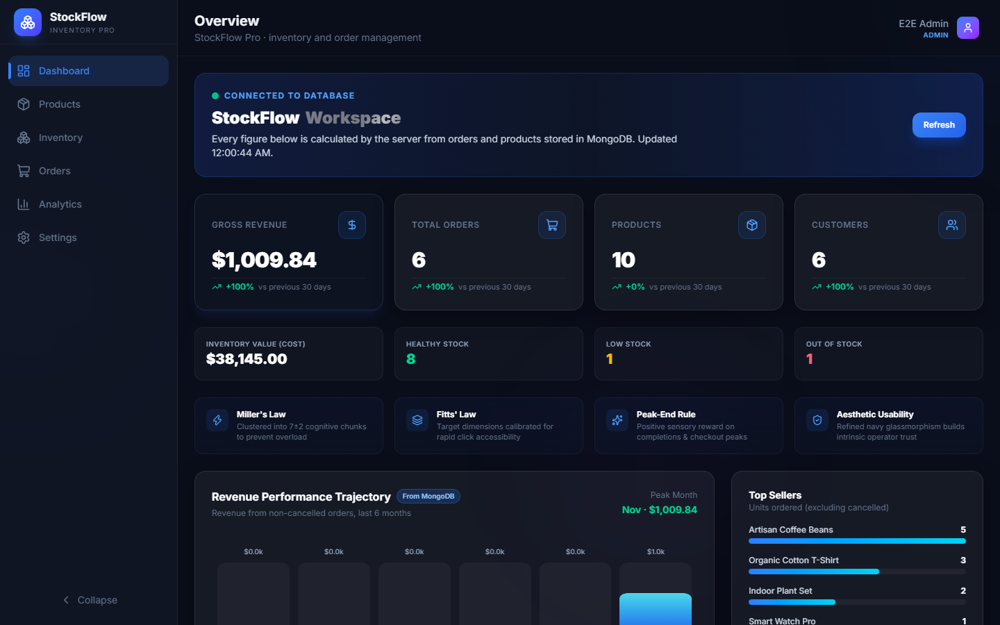
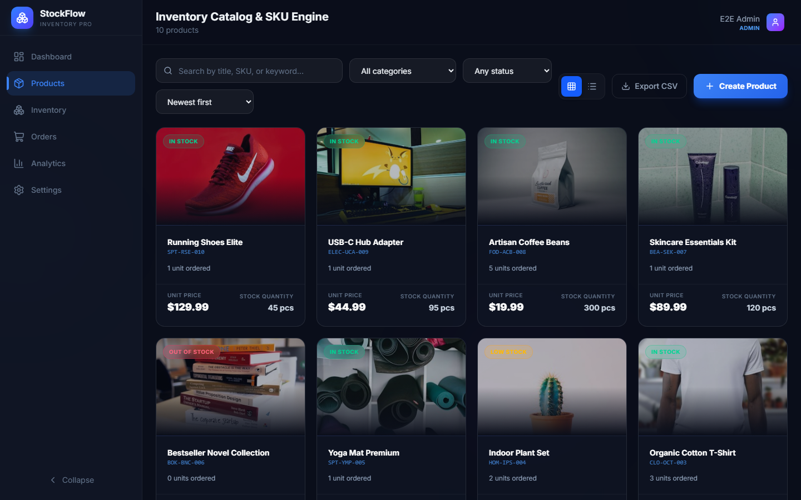
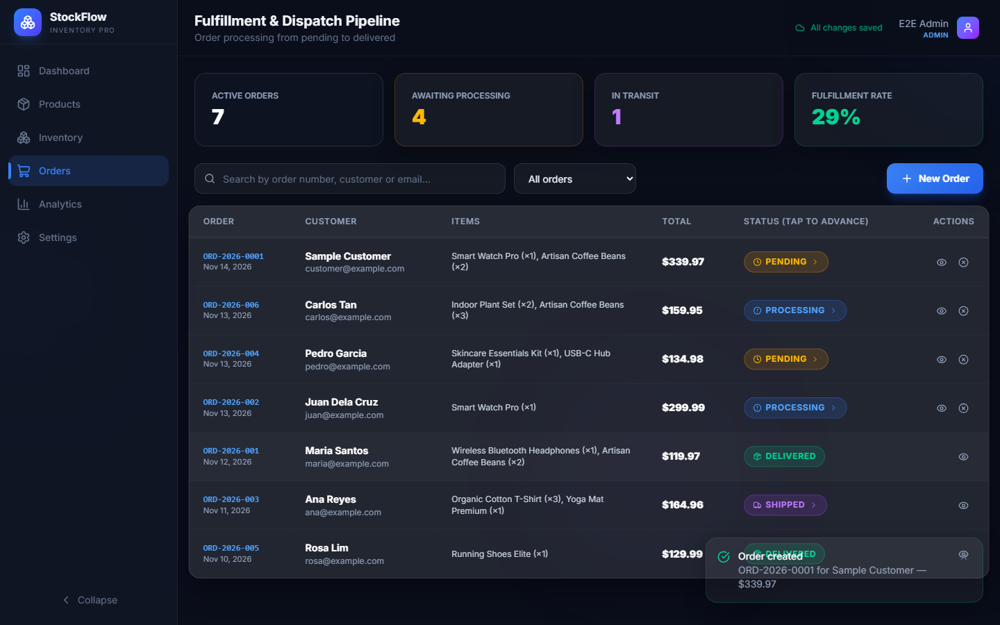
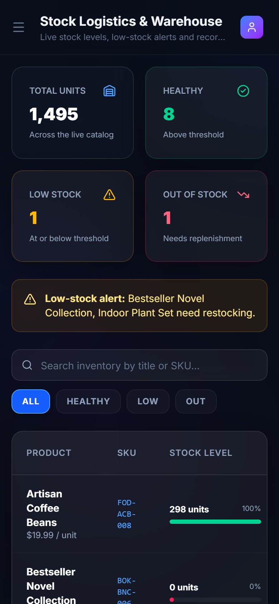

# StockFlow Pro — MERN Inventory & Order Management

StockFlow Pro is a small-business inventory and order workspace. The React front end (navy glassmorphism, GSAP, Lenis, React Bits–style cards, sheets and confirmation modals) talks to an Express API backed by MongoDB. Products, stock, orders and business settings live in the database. The browser keeps only harmless interface preferences.



| Products | Orders | Mobile |
| --- | --- | --- |
|  |  |  |

More screenshots are in [`docs/screenshots/`](docs/screenshots/), including the login screen, stock history, analytics, settings, and the [MongoDB collections](docs/screenshots/collections.png) (test data, with password hashes and session contents removed).

---

## Features

- **Sign-in and roles.** Accounts are created by an admin; there is no public sign-up. Two roles share one workspace: **admin** and **staff**.
- **Products.** Create, edit and delete, with server-side search, category and stock-status filters, sorting, pagination, grid or table view, and CSV export.
- **Inventory.** One-tap −1 / +5 / +20 buttons, adjustments with a reason, low-stock alerts, and a per-product movement history showing who changed what and when.
- **Orders.** Multi-item orders, the fulfillment path pending → processing → shipped → delivered, and cancellation that returns reserved stock.
- **Dashboard and analytics.** Revenue, orders, customers, average order value, gross margin, inventory value, stock health, a six-month revenue chart, category mix and order pipeline, all calculated from database records.
- **Optimistic updates.** Changes appear immediately and are marked *Saving…* until the server confirms them. Failures undo only the change that failed.
- **Tiered loading.** Nothing is shown for responses under 1 s, a content-shaped skeleton from 1–10 s, and after 10 s either real progress or an honest "time remaining unknown" state. There are no spinners and no silent fallback to sample data.

## Tech stack

React 19 + Vite 8 · Tailwind CSS 4 · GSAP · Lenis · Zustand · Node.js ≥ 20.19 · Express 5 · MongoDB 7 + Mongoose 8 · express-session + connect-mongo · bcryptjs · zod · helmet · express-rate-limit · Playwright · node:test + supertest + mongodb-memory-server.

```
server/
  app.js              Express app factory (security headers, sessions, CSRF, routes, static client)
  index.js / start.js Development and production entry points
  config.js           Environment configuration and validation
  db.js               Mongoose connection and transaction helper
  models/             User, Category, Product, Order, InventoryMovement, Setting,
                      IdempotencyRecord, Counter, ImportBatch
  middleware/         auth (sessions, roles, CSRF), error handling
  routes/             auth.js, resources.js (all other endpoints)
  services/           orders, inventory, products, dashboard, idempotency, legacy import, seed
  scripts/            create-admin, seed, e2e-server, screenshots
  seed/sampleData.js  Development sample data
  tests/              Backend tests on a real in-memory MongoDB replica set
src/
  api/client.js       fetch wrapper (CSRF, idempotency keys, error kinds, retries)
  store/              useAuth (session), useStore (data + optimistic mutation tracking)
  pages/              Login, Dashboard, Products, Inventory, Orders, Analytics, Settings
tests/workspace.spec.js  Playwright end-to-end tests
```

---

## Getting started

### 1. Install

Requires Node.js 20.19+ (or 22.12+) and npm.

```bash
git clone https://github.com/kythegallardo12-tech/WebApp-Duo.git
cd WebApp-Duo
npm ci
```

### 2. Start MongoDB as a replica set

Inventory changes use multi-document transactions, which need a replica set (a single node is fine).

**Option A — Docker (recommended).** [`docker-compose.yml`](docker-compose.yml) starts `mongo:7` as the single-node replica set `rs0` and initiates it automatically:

```bash
npm run db:up
```

Wait until `docker compose ps` shows the container as `healthy`. Data persists in the `mongo-data` volume; `npm run db:down` stops it.

**Option B — MongoDB Atlas.** Create a free cluster (Atlas clusters are always replica sets), add a database user, allow your IP address, and use the `mongodb+srv://…` connection string in `MONGODB_URI`.

**Option C — local `mongod`.** Run `mongod --replSet rs0 --dbpath <dir>`, then once in `mongosh` run `rs.initiate()`.

### 3. Configure environment variables

```bash
cp .env.example .env
```

| Variable | Purpose |
| --- | --- |
| `NODE_ENV` | `development`, `production` or `test` |
| `PORT` | API port (default `4000`). Vite proxies `/api` here in development. |
| `MONGODB_URI` | Replica-set connection string (Docker default is in `.env.example`) |
| `SESSION_SECRET` | Long random string that signs session cookies (32+ characters in production). Generate one with `node -e "console.log(require('crypto').randomBytes(48).toString('hex'))"` |
| `SESSION_TTL_MINUTES` | Absolute session lifetime (default 480) |
| `LOGIN_RATE_LIMIT` | Failed sign-ins allowed per IP + email per 15 minutes (default 10) |
| `CORS_ORIGINS` | Only if the UI is served from a different origin (comma-separated); leave empty otherwise |
| `TRUST_PROXY` | Number of reverse proxies in front of the app (defaults to `1` in production) |
| `ALLOW_DEV_RESET` | `true` enables the admin "Reset to sample data" tool. Always off in production. |

`.env` is git-ignored. No server secret is exposed to the browser bundle.

### 4. Create the first admin

There is no public registration endpoint and no built-in credentials. Create the first admin explicitly:

```bash
npm run create-admin -- --email you@example.com --name "Your Name"
```

You are prompted for a password (at least 10 characters, input hidden). For scripts you can set `ADMIN_PASSWORD` in the environment instead. Running the command again for an existing email promotes that user to admin and resets the password. Further admin and staff accounts are created in **Settings → Team**.

### 5. (Optional) Load sample data — development only

```bash
npm run seed
```

This loads 7 categories, 10 products and 6 historical orders. It is safe to run repeatedly: records are matched by sample id or SKU, so nothing is duplicated. Product stock is the opening balance, and sample orders do **not** deduct stock again. The command refuses to run when `NODE_ENV=production`.

### 6. Run in development

```bash
npm run dev
```

This starts the API (`node --watch`, port 4000) and Vite (port 5173) together. Open <http://localhost:5173>. Vite forwards `/api` to Express, so the browser sees a single origin.

---

## Scripts

| Command | What it does |
| --- | --- |
| `npm run dev` | API + Vite dev server together |
| `npm run build` | Production build of the front end into `dist/` |
| `npm start` | Production server: API and built front end on one origin (`PORT`) |
| `npm test` | Backend test suite (`npm run test:api`) |
| `npm run test:e2e` | Playwright end-to-end tests (run `npm run build` first) |
| `npm run test:all` | lint → backend tests → build → end-to-end tests |
| `npm run lint` | oxlint |
| `npm run seed` | Load development sample data |
| `npm run create-admin -- --email … --name …` | Create or promote an admin |
| `npm run db:up` / `npm run db:down` | Start / stop the Docker MongoDB replica set |

## Testing

**Backend (`npm test`).** 31 tests with `node:test` and supertest against a real single-node replica set started by `mongodb-memory-server` (the MongoDB binary is downloaded on first run). They never touch your development database. Coverage includes:

- login, logout, session expiry, deactivated users, CSRF, rate limiting and protected routes;
- the admin/staff permission matrix;
- product CRUD, survival across a server restart, duplicate SKUs (including two simultaneous creates) and invalid numbers;
- filtering, sorting, pagination and CSV export;
- stock adjustments and the negative-stock guard;
- two buyers competing for the last unit, twelve concurrent buyers never overselling, and all-or-nothing multi-item reservations;
- idempotent retries of orders and adjustments, and reuse of a key with a different payload being rejected;
- concurrent cancellations restoring stock exactly once, and invalid order transitions;
- order history surviving product edits and deletion;
- dashboard figures, repeatable seeding and legacy-data import.

**End-to-end (`npm run build && npm run test:e2e`).** 18 Playwright tests (Chromium) against the production build and the real API. [`server/scripts/e2e-server.js`](server/scripts/e2e-server.js) starts its own in-memory replica set — or uses `E2E_MONGODB_URI`, which must name a database containing `test` or `e2e` — and resets fixed test fixtures before each test. They cover:

- sign-in, sign-out, expired sessions and keyboard-only sign-in;
- role-dependent UI;
- product CRUD persisting across reloads, duplicate-SKU and validation feedback, server-side filters, pagination and CSV download;
- stock adjustments with history;
- multi-item orders, status changes and cancellation restoring stock;
- dashboard figures;
- optimistic rollback on a rejected change, and an idempotent retry after a dropped response (applied once);
- loading tiers (no loader, skeleton, indeterminate state);
- API errors with no sample-data fallback;
- the mobile navigation drawer and no horizontal scrolling at 375 px.

Install the browser once with `npx playwright install chromium`.

---

## Roles and permissions

All rules are enforced on the server (`server/middleware/auth.js`); the UI hides what a role cannot do.

| Capability | Staff | Admin |
| --- | :-: | :-: |
| View dashboard, analytics, products, inventory and orders | ✓ | ✓ |
| Create and edit products | ✓ | ✓ |
| Adjust stock | ✓ | ✓ |
| Create orders, advance status, cancel orders | ✓ | ✓ |
| Delete products, create categories | – | ✓ |
| Manage users | – | ✓ |
| Edit business settings | – | ✓ |
| Import browser data, reset sample data (dev only) | – | ✓ |

## Order states

```
pending ──► processing ──► shipped ──► delivered
   │             │
   └──── cancelled ◄┘
```

- Orders move forward one step at a time. Skipping a step or going backwards returns `409 INVALID_TRANSITION`.
- **Cancellation is allowed only while an order is `pending` or `processing`** (before it leaves the warehouse). It returns the reserved stock in the same transaction, exactly once. Shipped and delivered orders cannot be cancelled (`409 NOT_CANCELLABLE`), and the UI shows no cancel button for them.
- The original UI's "void order" deleted the order record. Orders are now never deleted, so history and reports stay complete.

## Data integrity

- **Money** is stored as integer cents (`priceCents`, `costCents`, `unitPriceCents`, `totalCents`). The API accepts and returns dollar amounts with at most two decimals.
- **SKUs** are normalized (trimmed, upper-case, spaces → `-`) and protected by a unique partial index on live products. Duplicates return `409 DUPLICATE_SKU` with a field error.
- **Identifiers.** Every entity is exposed as `id`, the 24-character hex MongoDB ObjectId. Products reference categories by that id. Sample and imported records also keep their old ids (`cat-1`, `prod-001`, …) in `legacyId` for repeatable seeding and imports.
- **Server-side pricing.** The server reads prices from the database and calculates totals; any client-supplied totals are ignored. Duplicate product lines are combined.
- **Order creation** runs in one MongoDB transaction: each line reserves stock with a conditional atomic update (`stock >= qty`), then the order and inventory movements are written. Any shortfall aborts everything.
- **Historical snapshots.** Order items store the product name, SKU, quantity, unit price and unit cost at the time of the order, so later edits or deletion do not change past orders.
- **Soft deletion.** A deleted product disappears from the catalog and cannot be ordered, but stays in the database for history; its SKU becomes reusable.
- **Stock** changes only through adjustments, orders and cancellations, each recorded in `inventorymovements` with the user and time. A normal product edit cannot change stock, so it can never overwrite someone else's stock change.
- **Stale edits.** Products and settings carry a `version`. Saving with an old version returns `409 STALE_VERSION` with the current record, which the UI shows so the user can re-apply the edit.
- **Idempotency.** Order creation, stock adjustments and cancellations require an `Idempotency-Key` header. The key and response are stored in the same transaction as the effect, so retries return the original result. Reusing a key with a different payload returns `422`. Keys expire after 48 hours.

## API summary

All endpoints are under `/api` and return JSON. Errors look like `{ "error": { "code", "message", "details?" } }` with status 400 (validation), 401 (signed out or expired), 403 (forbidden or bad CSRF token), 404, 409 (conflict), 422 (idempotency-key reuse) or 429 (rate limited). Mutations need the `X-CSRF-Token` header (returned by login and `/auth/me`).

| Method & path | Role | Notes |
| --- | --- | --- |
| `POST /auth/login` | public | `{ email, password }`; rate limited; sets HTTP-only cookie |
| `POST /auth/logout` | any | Destroys the session |
| `GET /auth/me` | signed in | Current user, permissions, CSRF token |
| `GET /categories` · `POST /categories` | any · admin | |
| `GET /products` | any | `q, category, status, sort, page, limit` → `{ items, total, page, pages }` |
| `GET /products/export.csv` | any | Same filters as the listing |
| `GET /products/:id` | any | |
| `POST /products` | staff+ | Opening `stock` allowed on create only |
| `PATCH /products/:id` | staff+ | Requires `version`; stock not editable |
| `DELETE /products/:id` | admin | Soft delete |
| `POST /products/:id/adjustments` | staff+ | `{ delta, reason }` + `Idempotency-Key` |
| `GET /inventory/movements` | any | `product, limit` |
| `GET /orders` · `GET /orders/:id` | any | `q, status, page, limit` |
| `POST /orders` | staff+ | `{ customer, email, address, items: [{ productId, qty }] }` + `Idempotency-Key` |
| `POST /orders/:id/transition` | staff+ | `{ to }` — next status only |
| `POST /orders/:id/cancel` | staff+ | `Idempotency-Key`; pending or processing only |
| `GET /dashboard` | any | Totals, growth, monthly revenue, top products, category mix, stock health |
| `GET /settings` · `PUT /settings` | any · admin | `PUT` requires `version` |
| `GET /users` · `POST /users` · `PATCH /users/:id` | admin | Create, change role, deactivate, reset password |
| `POST /import/legacy` | admin | Import browser data (see below) |
| `POST /dev/reset` | admin | Only when `ALLOW_DEV_RESET=true` outside production |
| `GET /health` | public | `{ ok }` |

## Security

- Passwords are hashed with bcrypt (cost 12). Hashes are never returned by the API.
- Sessions are stored in MongoDB (`sessions` collection). The cookie `sf.sid` is `HttpOnly`, `SameSite=Lax`, and `Secure` in production. Sessions have an absolute lifetime (`SESSION_TTL_MINUTES`); the id is regenerated at login; logout destroys the session; deactivated users are signed out on their next request.
- CSRF: a synchronizer token is stored in the session and must be sent as `X-CSRF-Token` on every mutation.
- Login is rate limited per IP + email. Unknown emails and wrong passwords get the same response.
- `helmet` security headers with a restrictive Content-Security-Policy. CORS is disabled unless `CORS_ORIGINS` is set.
- CSV export neutralizes spreadsheet formula injection.

## Data from the old browser-only version

Earlier builds stored everything in `localStorage` under `stockflow-storage` (and `webapp-duo-workspace-v1` for the workspace build). That data is **not** uploaded automatically. To bring it into the database:

1. Sign in as an admin in the same browser that holds the old data.
2. Open **Settings → Data tools → Import data saved in this browser**. The detected keys are listed with their product and order counts.
3. Click **Import to database**.

The import is validated and runs in one transaction. Categories are mapped by old id or name; products by old id, then SKU; orders by old id. Running it twice does nothing new: the same payload returns `409 ALREADY_IMPORTED`, and records that already exist are skipped. Imported stock becomes the opening balance, and imported orders are stored as historical (`stockReserved: false`), so they never deduct stock and cancelling them does not add stock back. The local copy is kept until you click **Remove local copy**.

The app now keeps only interface preferences (sidebar state, default product layout) in `localStorage`, under `stockflow-ui-preferences`.

## Production deployment

```bash
npm ci
npm run build
NODE_ENV=production MONGODB_URI=... SESSION_SECRET=... PORT=8080 npm start
```

`npm start` runs `server/start.js`, which defaults `NODE_ENV` to `production` and serves both the API and `dist/` from one origin, so no CORS setup is needed. Checklist:

- Use a replica set or Atlas for `MONGODB_URI`, and a strong `SESSION_SECRET` (32+ characters; startup fails otherwise).
- Terminate HTTPS at your host or proxy. Secure cookies need HTTPS; set `TRUST_PROXY` to the number of proxies (default 1).
- Create the first admin with `npm run create-admin` against the production database. Do **not** run `npm run seed` (it refuses in production) and leave `ALLOW_DEV_RESET` unset.
- Health check: `GET /api/health`.

This works on any Node host (Render, Railway, Fly.io, a VPS) with MongoDB Atlas.

## Known limitations

- The inventory page, order form and optimistic overlays work from a full catalog load capped at 500 products. The Products page itself is paginated on the server and has no cap.
- Orders created by the API are numbered `ORD-YYYY-NNNN`; seeded and imported orders keep their old numbers (for example `ORD-2026-001`).
- No password-reset email flow: admins reset passwords in **Settings → Team**, or with `npm run create-admin`.
- A single shared workspace, without multi-tenant separation.
- Customers are stored on each order rather than in their own collection, so there is no customer directory.
- Currency is a display setting only: amounts are not converted, and the UI formats them with `$`.
- The Docker Compose replica set is for local development (no authentication, one node). Use Atlas or a secured replica set in production.
- Playwright runs only in Chromium.

## License

Academic project.
